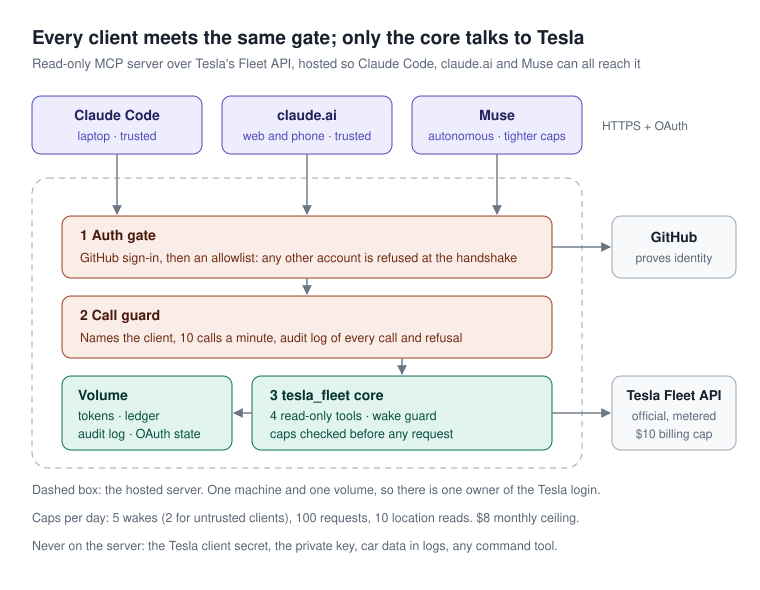

# tesla-fleet-mcp

Ask Claude about your Tesla. A read-only MCP server over Tesla's official Fleet API, built so an AI client can answer "what's my battery?" without ever being able to send a command to the car.

**Status:** Phase 1 (read-only, local) live since 2026-10-12 against a real vehicle. Phase 2 (hosted, reachable from claude.ai and Muse) built and tested; deployment in progress.
**Project page:** https://toneeraj.github.io/tesla-fleet-mcp/
**Full design write-up:** https://claude.ai/code/artifact/91137cdf-1812-4e6a-8c5c-69acbea7a126



## What it does

Four tools, all read-only:

| Tool | Returns | Guard |
| --- | --- | --- |
| `list_vehicles` | Vehicles with online or asleep state | Never wakes the car |
| `get_vehicle_status` | Battery %, range, charging state, lock, climate, odometer | Returns `asleep` unless `wake=True`; location only on request |
| `get_charging_history` | Supercharger sessions and cost in a date range | Home charging not covered |
| `get_api_spend` | Calls made and estimated spend against the monthly credit | Reads the local ledger; no Tesla call |

## Design rules

- **No commands.** No tool can lock, unlock, or change anything on the car.
- **No passthrough.** There is no raw "call any endpoint" tool.
- **No polling.** Tesla is called only when a question is asked.
- **One token owner.** Tesla refresh tokens are single-use. Only the core reads and writes the token file, and it saves each new refresh token immediately.
- **Thin wrapper.** All logic lives in `tesla_fleet.core`. The MCP server only publishes it as tools.

## How a question flows

Client → auth gate → call guard → core (`tesla_fleet.core`) → Tesla Fleet API.
The core refreshes tokens, enforces caps, records spend, applies the wake guard, and returns about ten fields instead of the full vehicle payload. Run locally over stdio, the auth gate and call guard are not needed: the only client is you on your own machine.

## Hosted mode: safety layers

Hosting makes the server reachable from claude.ai (web and phone) and Muse. Each layer answers one way it could go wrong.

| Risk | Layer | What it does |
| --- | --- | --- |
| A stranger finds the URL | Auth gate | GitHub sign-in, then an allowlist. GitHub sign-in alone admits any GitHub user; the allowlist refuses every other account at the handshake, before it can list tools. |
| An agent is steered by a malicious email or page | Read-only tools + caps | Nothing it can call changes the car. Caps are checked before a request is sent, so a refused call costs nothing. |
| An agent loops | Rate limit + caps | 10 calls a minute per client; daily caps on wakes, requests and location reads; an $8 monthly spend ceiling under Tesla's $10 billing cap. |
| An autonomous client overspends wakes | Client naming | Each client is named by where its sign-in returns to. Claude Code and claude.ai are trusted; anything else, Muse included, gets 2 wakes a day instead of 5. |
| Something goes wrong unnoticed | Audit log | One JSON line per call, cap refusal, refused account and rejected token. It records *that* location was read, never where the car was, and no car data at all. Kept 90 days. |
| Two copies of the Tesla login | Single owner | One machine, one volume. The laptop stops holding tokens. |
| The host is compromised | Least secrets | The server holds only the Tesla client ID and tokens. The client secret and private key stay on the laptop. Revoke access from the Tesla account at any time. |

**Secrets** live in a 1Password vault. GitHub holds exactly one secret, a 1Password service-account token that can only read that vault; the deploy workflow loads the rest by reference (`op://tesla-fleet/...`), masks them, and hands them to Fly. Deploy from the browser: **Actions → Deploy → Run workflow**.

Caps are values, not logic: set `CAP_WAKES_PER_DAY`, `CAP_REQUESTS_PER_DAY`, `CAP_MONTHLY_CEILING_USD`, `CAP_LOCATION_PER_DAY`, `CAP_CALLS_PER_MINUTE` and `CAP_UNTRUSTED_WAKES_PER_DAY` to tune them.

## Setup

### Prerequisites

- Python 3.11+
- A Tesla account with a vehicle
- A domain that can host a public key (this project uses GitHub Pages)

### One-time Tesla setup

1. Generate an EC `prime256v1` key pair in `~/.tesla-fleet/` (never in this repo).
2. Host the public key at `https://<your-domain>/.well-known/appspecific/com.tesla.3p.public-key.pem`. On GitHub Pages, add `.well-known` to the `include:` list in `_config.yml` so Jekyll serves the folder.
3. Create a developer app at https://developer.tesla.com with:
   - allowed origin: your domain
   - redirect URI: `http://localhost:8080/callback`
   - scopes: Vehicle Information, Vehicle Location, Vehicle Charging Management (nothing else)
4. Put the credentials in `~/.tesla-fleet/.env`:

   ```
   TESLA_CLIENT_ID=...
   TESLA_CLIENT_SECRET=...
   TESLA_DOMAIN=your-domain
   TESLA_REGION=na
   ```

### Install, register, log in

```bash
python -m venv .venv && source .venv/bin/activate
pip install -e .
python -m tesla_fleet.register_partner   # one time: ties the app to your domain
python -m tesla_fleet.login              # opens a browser; saves ~/.tesla-fleet/tokens.json
```

### Connect to Claude Code

```bash
claude mcp add --scope user tesla-fleet -- "$(pwd)/.venv/bin/python" -m tesla_fleet.server
```

Restart Claude Code and ask: *"What's my battery?"*

## Tests

```bash
pip install -e '.[dev]'
pytest
```

Tests use mocked HTTP and cover token rotation, the wake guard, the spend ledger, response shaping, that the MCP surface is exactly four read-only tools, and every hosted-mode guard: a stranger refused at the handshake, each cap, the rate limit, client naming, and an audit log that never contains car data.

## Secrets

Nothing secret lives in this repository. `~/.tesla-fleet/` holds the private key, client credentials, and tokens. `.gitignore` blocks `.env`, `*.pem`, and `tokens.json` as a second line of defense.

## Project layout

```
tesla_fleet/
  config.py            # endpoints, scopes, price constants, reads ~/.tesla-fleet/.env
  core.py              # auth refresh, wake guard, spend ledger, Tesla calls
  server.py            # FastMCP wrapper: the four tools, no logic
  remote.py            # hosted mode: GitHub sign-in, allowlist, call guard, audit log
  register_partner.py  # one-time domain registration
  login.py             # one-time OAuth login with local callback
tests/                 # pytest, mocked HTTP; no live Tesla calls
docs/architecture.svg  # the diagram above
Dockerfile, fly.toml   # hosted deployment: one machine, one volume
```

## Roadmap

1. **Phase 1:** read-only, one client (Claude Code). *Live.*
2. **Phase 2:** hosted server that owns the tokens and serves Claude Code, claude.ai and Muse behind the safety layers above. *Built and tested; deploying.*
3. **Phase 3:** a few signed commands (lock, climate), each requiring confirmation, after virtual key pairing.

## License

MIT

Built by [Neeraj Singh](https://github.com/toneeraj).
